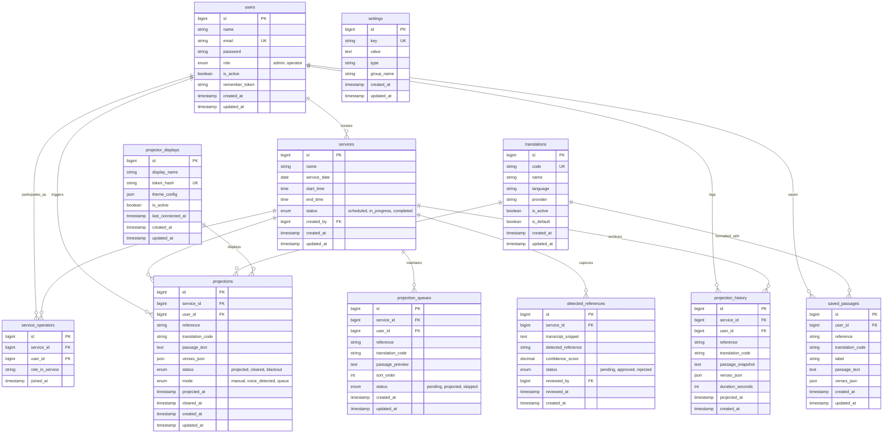

# BibleCast — Database Design & Schema Specification

## 1. Database Overview

* **Database Engine:** MySQL 8.0+ / MariaDB 10.5+
* **Default Database Name:** `church_bible_projection`
* **Default Collation:** `utf8mb4_unicode_ci`
* **Storage Engine:** InnoDB (Foreign Key & Transaction support)
* **ORM:** Laravel Eloquent

The database structure is designed to support high-speed live lookups, real-time WebSocket synchronization, historical snapshot logging, multi-operator collaboration, and church service management.

---

## 2. Entity-Relationship Diagram (ERD)



---

## 3. Detailed Data Dictionaries & Table Schemas

### 3.1 `users`
Stores credentials and permissions for media team operators and directors.

| Field | Type | Attributes | Nullable | Default | Description |
|---|---|---|---|---|---|
| `id` | BIGINT UNSIGNED | AUTO_INCREMENT, PK | NO | - | Unique user identifier |
| `name` | VARCHAR(191) | - | NO | - | Full name of operator |
| `email` | VARCHAR(191) | UNIQUE | NO | - | User login email address |
| `email_verified_at` | TIMESTAMP | - | YES | NULL | Email verification timestamp |
| `password` | VARCHAR(191) | - | NO | - | Hashed password (bcrypt) |
| `role` | ENUM('admin', 'operator') | INDEX | NO | 'operator' | Authorization role |
| `is_active` | BOOLEAN | INDEX | NO | 1 | Account activation status |
| `remember_token` | VARCHAR(100) | - | YES | NULL | Laravel remember token |
| `created_at` | TIMESTAMP | - | YES | NULL | Creation timestamp |
| `updated_at` | TIMESTAMP | - | YES | NULL | Last modification timestamp |

---

### 3.2 `services`
Represents individual church gatherings (e.g. Sunday Morning Service, Midweek Communion, Youth Service).

| Field | Type | Attributes | Nullable | Default | Description |
|---|---|---|---|---|---|
| `id` | BIGINT UNSIGNED | AUTO_INCREMENT, PK | NO | - | Unique service identifier |
| `name` | VARCHAR(191) | - | NO | - | Service title (e.g. "Sunday 1st Service") |
| `service_date` | DATE | INDEX | NO | - | Scheduled calendar date |
| `start_time` | TIME | - | YES | NULL | Actual / planned start time |
| `end_time` | TIME | - | YES | NULL | Actual / planned completion time |
| `status` | ENUM('scheduled', 'in_progress', 'completed') | INDEX | NO | 'scheduled' | Service lifecycle status |
| `created_by` | BIGINT UNSIGNED | FK -> users.id | NO | - | Administrator who created the service |
| `created_at` | TIMESTAMP | - | YES | NULL | Record created timestamp |
| `updated_at` | TIMESTAMP | - | YES | NULL | Record updated timestamp |

* **Foreign Keys:**
  - `created_by` REFERENCES `users(id)` ON DELETE RESTRICT

---

### 3.3 `service_operators`
Pivot table tracking media operators assigned to or collaborating in a service session.

| Field | Type | Attributes | Nullable | Default | Description |
|---|---|---|---|---|---|
| `id` | BIGINT UNSIGNED | AUTO_INCREMENT, PK | NO | - | Pivot identifier |
| `service_id` | BIGINT UNSIGNED | FK -> services.id | NO | - | Associated church service |
| `user_id` | BIGINT UNSIGNED | FK -> users.id | NO | - | Assigned media operator |
| `role_in_service` | VARCHAR(100) | - | YES | 'primary_operator'| Role in booth (e.g. audio listener, projector lead) |
| `joined_at` | TIMESTAMP | - | NO | CURRENT_TIMESTAMP | When operator clocked into service |

* **Indexes:**
  - UNIQUE KEY `service_user_unique` (`service_id`, `user_id`)

---

### 3.4 `translations`
Catalog of active Bible translations available for projection.

| Field | Type | Attributes | Nullable | Default | Description |
|---|---|---|---|---|---|
| `id` | BIGINT UNSIGNED | AUTO_INCREMENT, PK | NO | - | Unique translation ID |
| `code` | VARCHAR(20) | UNIQUE | NO | - | Standard acronym (`kjv`, `web`, `nkjv`, `amp`) |
| `name` | VARCHAR(100) | - | NO | - | Display title (e.g. "King James Version") |
| `language` | VARCHAR(10) | - | NO | 'en' | ISO language code |
| `provider` | VARCHAR(50) | - | NO | 'bible-api' | Integration adapter key |
| `is_active` | BOOLEAN | INDEX | NO | 1 | Whether operators can select this version |
| `is_default` | BOOLEAN | - | NO | 0 | Default translation on startup |
| `created_at` | TIMESTAMP | - | YES | NULL | Creation timestamp |
| `updated_at` | TIMESTAMP | - | YES | NULL | Modification timestamp |

---

### 3.5 `projections`
Represents the current live projection state and recent live commands sent to sanctuary screens.

| Field | Type | Attributes | Nullable | Default | Description |
|---|---|---|---|---|---|
| `id` | BIGINT UNSIGNED | AUTO_INCREMENT, PK | NO | - | Projection event ID |
| `service_id` | BIGINT UNSIGNED | FK -> services.id | YES | NULL | Active church service session |
| `user_id` | BIGINT UNSIGNED | FK -> users.id | NO | - | Operator who authorized the projection |
| `reference` | VARCHAR(100) | INDEX | NO | - | Standardized citation (e.g. "John 3:16") |
| `translation_code` | VARCHAR(20) | - | NO | 'kjv' | Translation used |
| `passage_text` | TEXT | - | NO | - | Full text of projected scripture |
| `verses_json` | JSON | - | NO | - | Structured verse array `[{verse: 16, text: "..."}]` |
| `status` | ENUM('projected', 'cleared', 'blackout') | INDEX | NO | 'projected' | Projector visual state |
| `mode` | ENUM('manual', 'voice_detected', 'queue') | - | NO | 'manual' | How the passage was selected |
| `projected_at` | TIMESTAMP | INDEX | NO | CURRENT_TIMESTAMP | Exact display trigger time |
| `cleared_at` | TIMESTAMP | - | YES | NULL | When display was cleared/replaced |
| `created_at` | TIMESTAMP | - | YES | NULL | Creation timestamp |
| `updated_at` | TIMESTAMP | - | YES | NULL | Modification timestamp |

---

### 3.6 `projection_history`
Immutable audit log of all scriptures displayed throughout the church service.

| Field | Type | Attributes | Nullable | Default | Description |
|---|---|---|---|---|---|
| `id` | BIGINT UNSIGNED | AUTO_INCREMENT, PK | NO | - | History record ID |
| `service_id` | BIGINT UNSIGNED | FK -> services.id | YES | NULL | Associated service |
| `user_id` | BIGINT UNSIGNED | FK -> users.id | NO | - | Operator who triggered projection |
| `reference` | VARCHAR(100) | INDEX | NO | - | Bible reference |
| `translation_code` | VARCHAR(20) | - | NO | - | Bible translation code |
| `passage_snapshot` | TEXT | - | NO | - | Complete preserved text |
| `verses_json` | JSON | - | YES | NULL | Parsed verses structure |
| `duration_seconds` | INT UNSIGNED | - | YES | 0 | Total time displayed on screen |
| `projected_at` | TIMESTAMP | INDEX | NO | - | Projection start time |
| `created_at` | TIMESTAMP | - | YES | NULL | Record created timestamp |

---

### 3.7 `projection_queues`
Order of service scripture lineup pre-configured or queued during preaching.

| Field | Type | Attributes | Nullable | Default | Description |
|---|---|---|---|---|---|
| `id` | BIGINT UNSIGNED | AUTO_INCREMENT, PK | NO | - | Queue item ID |
| `service_id` | BIGINT UNSIGNED | FK -> services.id | NO | - | Associated church service |
| `user_id` | BIGINT UNSIGNED | FK -> users.id | NO | - | Operator who queued the item |
| `reference` | VARCHAR(100) | - | NO | - | Bible reference |
| `translation_code` | VARCHAR(20) | - | NO | 'kjv' | Bible translation code |
| `passage_preview` | VARCHAR(255) | - | YES | NULL | First 100 characters of verse |
| `sort_order` | INT UNSIGNED | INDEX | NO | 0 | Display sequence order |
| `status` | ENUM('pending', 'projected', 'skipped') | INDEX | NO | 'pending' | Processing status |
| `created_at` | TIMESTAMP | - | YES | NULL | Created timestamp |
| `updated_at` | TIMESTAMP | - | YES | NULL | Updated timestamp |

---

### 3.8 `detected_references`
Logs speech recognition detections, transcription snippets, and operator approval decisions.

| Field | Type | Attributes | Nullable | Default | Description |
|---|---|---|---|---|---|
| `id` | BIGINT UNSIGNED | AUTO_INCREMENT, PK | NO | - | Detection record ID |
| `service_id` | BIGINT UNSIGNED | FK -> services.id | YES | NULL | Associated service |
| `transcript_snippet`| TEXT | - | NO | - | Spoken phrase context from preacher |
| `detected_reference`| VARCHAR(100) | INDEX | NO | - | Parsed scripture reference |
| `confidence_score` | DECIMAL(4,3) | - | NO | 0.000 | Match confidence (0.000 to 1.000) |
| `status` | ENUM('pending', 'approved', 'rejected') | INDEX | NO | 'pending' | Operator review status |
| `reviewed_by` | BIGINT UNSIGNED | FK -> users.id | YES | NULL | Operator who decided |
| `reviewed_at` | TIMESTAMP | - | YES | NULL | Review decision timestamp |
| `created_at` | TIMESTAMP | - | YES | NULL | Detection timestamp |

---

### 3.9 `saved_passages`
Personal or media team bookmarks of frequently used scripture verses.

| Field | Type | Attributes | Nullable | Default | Description |
|---|---|---|---|---|---|
| `id` | BIGINT UNSIGNED | AUTO_INCREMENT, PK | NO | - | Bookmark ID |
| `user_id` | BIGINT UNSIGNED | FK -> users.id | NO | - | Operator who bookmarked |
| `reference` | VARCHAR(100) | INDEX | NO | - | Scripture reference |
| `translation_code` | VARCHAR(20) | - | NO | 'kjv' | Translation |
| `label` | VARCHAR(100) | - | YES | NULL | Custom tag (e.g. "Tithes", "Salvation") |
| `passage_text` | TEXT | - | NO | - | Full verse text |
| `verses_json` | JSON | - | YES | NULL | Structured verse objects |
| `created_at` | TIMESTAMP | - | YES | NULL | Created timestamp |
| `updated_at` | TIMESTAMP | - | YES | NULL | Updated timestamp |

---

### 3.10 `projector_displays`
Authorizes and configures dedicated display hardware connected to sanctuary projectors.

| Field | Type | Attributes | Nullable | Default | Description |
|---|---|---|---|---|---|
| `id` | BIGINT UNSIGNED | AUTO_INCREMENT, PK | NO | - | Display screen ID |
| `display_name` | VARCHAR(100) | - | NO | 'Main Sanctuary Projector' | Human readable screen label |
| `token_hash` | VARCHAR(64) | UNIQUE | NO | - | SHA-256 hash of secret projector URL token |
| `theme_config` | JSON | - | NO | - | Display styles (font size, font family, colors) |
| `is_active` | BOOLEAN | INDEX | NO | 1 | Revocation switch |
| `last_connected_at`| TIMESTAMP | - | YES | NULL | Heartbeat of active display |
| `created_at` | TIMESTAMP | - | YES | NULL | Created timestamp |
| `updated_at` | TIMESTAMP | - | YES | NULL | Updated timestamp |

* **Default `theme_config` JSON:**
```json
{
  "background_color": "#05080C",
  "text_color": "#FFFFFF",
  "reference_color": "#E5C76B",
  "font_family": "Georgia, serif",
  "font_size_clamp": "clamp(28px, 5vw, 60px)",
  "text_align": "center",
  "show_watermark": true
}
```

---

### 3.11 `settings`
Global system configuration key-value storage.

| Field | Type | Attributes | Nullable | Default | Description |
|---|---|---|---|---|---|
| `id` | BIGINT UNSIGNED | AUTO_INCREMENT, PK | NO | - | Setting ID |
| `key` | VARCHAR(100) | UNIQUE | NO | - | Setting configuration key |
| `value` | TEXT | - | YES | NULL | Setting configuration value |
| `type` | VARCHAR(30) | - | NO | 'string' | Data type (`string`, `boolean`, `integer`, `json`) |
| `group_name` | VARCHAR(50) | INDEX | NO | 'general' | Logical group (`general`, `projection`, `speech`) |
| `created_at` | TIMESTAMP | - | YES | NULL | Created timestamp |
| `updated_at` | TIMESTAMP | - | YES | NULL | Updated timestamp |

---

## 4. Database Migrations Order

When building or migrating BibleCast with `php artisan migrate`, migrations execute in the following exact dependency order:

1. `2024_01_01_000001_create_users_table.php`
2. `2024_01_01_000002_create_services_table.php`
3. `2024_01_01_000003_create_service_operators_table.php`
4. `2024_01_01_000004_create_translations_table.php`
5. `2024_01_01_000005_create_projections_table.php`
6. `2024_01_01_000006_create_projection_history_table.php`
7. `2024_01_01_000007_create_projection_queues_table.php`
8. `2024_01_01_000008_create_detected_references_table.php`
9. `2024_01_01_000009_create_saved_passages_table.php`
10. `2024_01_01_000010_create_projector_displays_table.php`
11. `2024_01_01_000011_create_settings_table.php`

---

## 5. Seed Data Requirements

When executing `php artisan db:seed`, the database must populate:
1. **Default Administrator:**
   - Email: `admin@biblecast.local`
   - Role: `admin`
2. **Standard Translations:**
   - `kjv` (King James Version, Provider: `bible-api`, Default: `true`)
   - `web` (World English Bible, Provider: `bible-api`, Default: `false`)
3. **Primary Sanctuary Display Screen:**
   - Name: `Sanctuary Main Projector`
   - Token Hash: Generated via SHA-256 for initial connection
4. **Default System Settings:**
   - `speech_engine_mode` -> `"hybrid"`
   - `projector_default_theme` -> `"dark"`
   - `operator_approval_required` -> `"true"`

